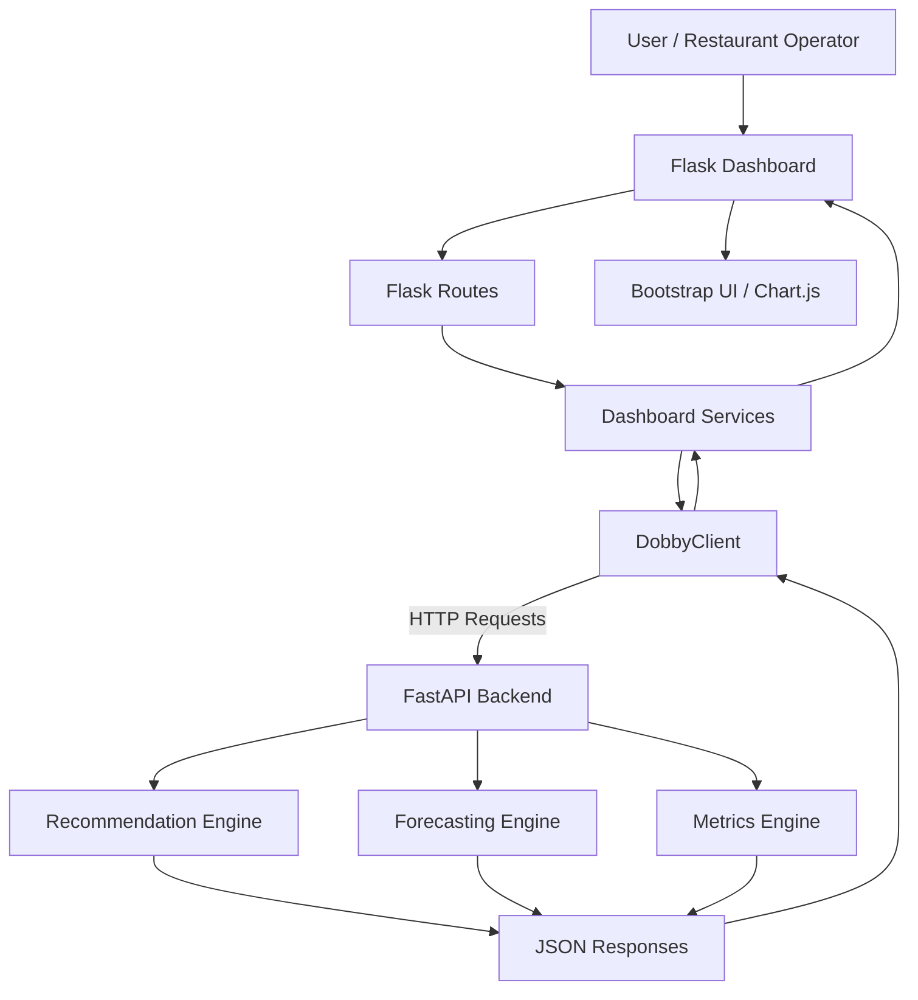

# DOBBY Intelligence

A standalone Flask-based dashboard for restaurant analytics, powered by the [DOBBY API](https://dobby-api-system.onrender.com/docs).

The dashboard provides an interactive interface for exploring product recommendations, demand forecasts, model performance and business analytics.

It does not implement recommendation or forecasting logic itself. All model outputs are requested from the backend API over HTTP.

Developed as part of the **4th Student Open Innovation Competition of the National and Kapodistrian University of Athens (NKUA)**, held on November 6–8, 2026.

The project was developed in a time-constrained, hackathon-style environment, using AI-assisted development as part of the implementation process.

## Live Demo

- **Dashboard:** [DOBBY Intelligence](https://dobby-web-dashboard.onrender.com)
- **Backend API:** [DOBBY API Documentation](https://dobby-api-system.onrender.com/docs)

## Related Repositories

The application consists of two separate but interconnected components:

| Component | Description |
|---|---|
| **Web Dashboard** | This repository. A Flask-based interface for exploring restaurant analytics. |
| **Backend API** | [DOBBY API System](https://github.com/konsamarinas/Dobby-APi-System) — A FastAPI backend responsible for recommendations, demand forecasting and performance metrics. |

The dashboard communicates with the API through HTTP requests using a centralized API client.

## Features

### Overview

A centralized view of the system, including:

- API health and availability.
- Recommendation metrics.
- Forecasting metrics.
- Model versions.
- Measured business impact, when available from the API.

### Metrics & Health

Dedicated pages for monitoring system status and evaluating model performance.

- Transparent evaluation details.
- Recommendation and forecasting metrics.
- API health information.
- Manual data refresh.

### Recommendations Playground

An interactive environment for testing product recommendations.

- Accepts operator-entered shopping basket data.
- Uses the verified `POST /recommendations` API schema.
- Displays the recommendations returned by the backend.
- Supports experimentation with different basket combinations.

The recommendation engine itself runs exclusively in the API.

### Forecasting

An interface for exploring future product and category demand.

- Uses the verified `GET /forecast` query parameters.
- Supports product-level and category-level forecasting.
- Displays forecast points, prediction bounds, selected model and evaluation metrics.
- Validates product and category identifiers before sending requests.

## Technology Stack

| Technology | Purpose |
|---|---|
| Python | Core programming language |
| Flask | Web application framework |
| Bootstrap 5 | Responsive interface |
| Chart.js | Data visualization |
| Requests | HTTP communication with the backend API |
| Vanilla JavaScript | Client-side interactions |
| Gunicorn | Production WSGI server |
| Render | Application deployment |

## Architecture

The dashboard follows a simple separation-of-responsibilities architecture.



The centralized `DobbyClient` is the only module responsible for communicating with the backend API.

Flask routes expose server-rendered pages and JSON proxy endpoints consumed by vanilla JavaScript.

This separation keeps the dashboard independent of the underlying recommendation and forecasting implementations.

## Project Structure

The main architectural components are:

```text
dobby-web-dashboard/
├── app/
│   ├── routes/
│   ├── services/
│   │   └── dobby_client.py
│   ├── templates/
│   └── static/
├── run.py
├── requirements.txt
├── .env.example
└── README.md
```

*The structure above illustrates the main application components.*

## Local Development

### Prerequisites

- Python 3.10+
- pip
- Access to the DOBBY API, either locally or through its deployed instance.

### Installation

Clone the repository:

```bash
git clone <repository-url>
cd dobby-web-dashboard
```

Create and activate a virtual environment:

```bash
python -m venv .venv
source .venv/bin/activate
```

On Windows:

```bash
.venv\Scripts\activate
```

Install dependencies:

```bash
pip install -r requirements.txt
```

Create the environment configuration:

```bash
cp .env.example .env
```

Start the application:

```bash
python run.py
```

Open the dashboard:

```text
http://localhost:5050
```

The application loads `.env` directly when started with either `python run.py` or the Flask CLI.

### Running Both Applications Locally

For local development, the API and dashboard can run independently in separate terminals.

**Terminal 1 — DOBBY API**

From the API repository:

```bash
cd /path/to/DOBBY
source .venv/bin/activate
uvicorn src.main:app --reload --port 8000
```

**Terminal 2 — Dashboard**

From the dashboard repository:

```bash
cd /path/to/dobby-web-dashboard
source .venv/bin/activate
python run.py
```

The dashboard then communicates with:

```text
http://127.0.0.1:8000
```

Alternatively, the deployed API can be selected explicitly:

```bash
DOBBY_API_URL=https://dobby-api-system.onrender.com python run.py
```

## Environment Variables

| Variable | Default | Description |
|---|---|---|
| `DOBBY_API_URL` | `https://dobby-api-system.onrender.com` | Backend API base URL |
| `DOBBY_API_CONNECT_TIMEOUT` | `5` | Connection timeout in seconds |
| `DOBBY_API_READ_TIMEOUT` | `45` | Response read timeout in seconds, allowing for Render cold starts |
| `DOBBY_CACHE_TTL` | `30` | Cache duration for health and metrics |
| `DOBBY_API_RETRIES` | `1` | Maximum additional retry for transient GET failures |
| `LOG_LEVEL` | `INFO` | Python logging level |

A shell environment variable takes precedence over the value defined in `.env`.

## Render Deployment

The dashboard is deployed as a separate Render Web Service.

**Deployment configuration:**

| Setting | Value |
|---|---|
| Build Command | `pip install -r requirements.txt` |
| Start Command | `gunicorn run:app` |
| Environment Variable | `DOBBY_API_URL` |

Set `DOBBY_API_URL` to the deployed DOBBY API base URL:

```text
https://dobby-api-system.onrender.com
```

The dashboard communicates with the backend through server-side HTTP requests. No API credentials are placed in browser JavaScript.

## API Limitations & Data Handling

The dashboard reflects the capabilities and limitations of the existing backend API.

- The API currently does not expose a catalog/list endpoint.
- There is no business-level forecasting mode.
- Product forecasting uses `level=product` with product IDs such as `shop_commercial_prod_freddo_espresso`.
- Category forecasting uses `level=category` with category IDs such as `shop_commercial_cat_coffee`.
- The playground accepts operator-entered IDs and validates category/product level compatibility before making requests.
- Forecast responses contain forecast points, prediction bounds, the selected model and evaluation metrics.

The API does not provide historical observations in its forecast responses. Consequently, the dashboard does not fabricate or display historical data that the backend has not supplied.

## Project Context

DOBBY Intelligence was developed during the **4th Student Open Innovation Competition of NKUA**, held on November 6–8, 2026.

The dashboard was designed to provide restaurant operators with an accessible interface for exploring analytical capabilities through a separate backend API.

The two repositories together form the application's frontend and backend components.

## License

This project is licensed under the MIT License. See the `LICENSE` file for details.

Copyright (c) 2026 Dobby Team
